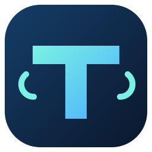
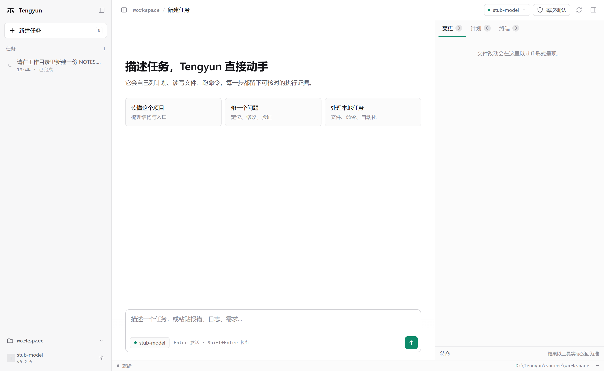
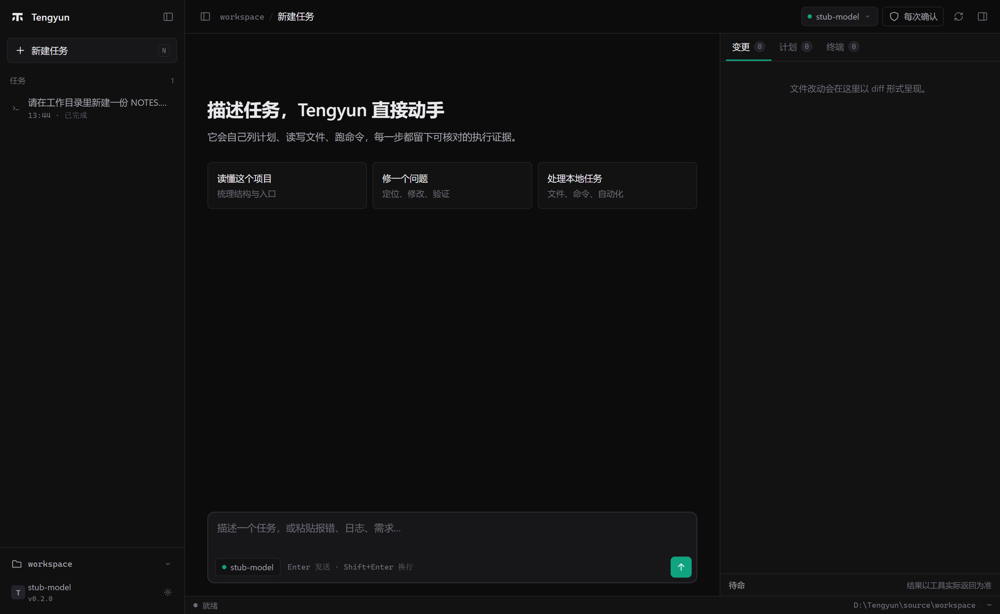
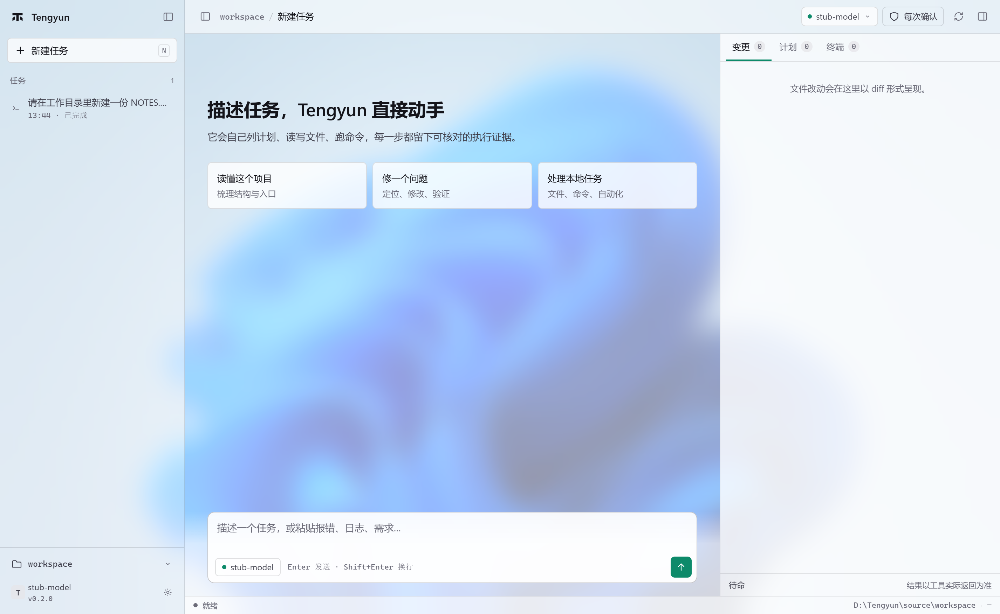
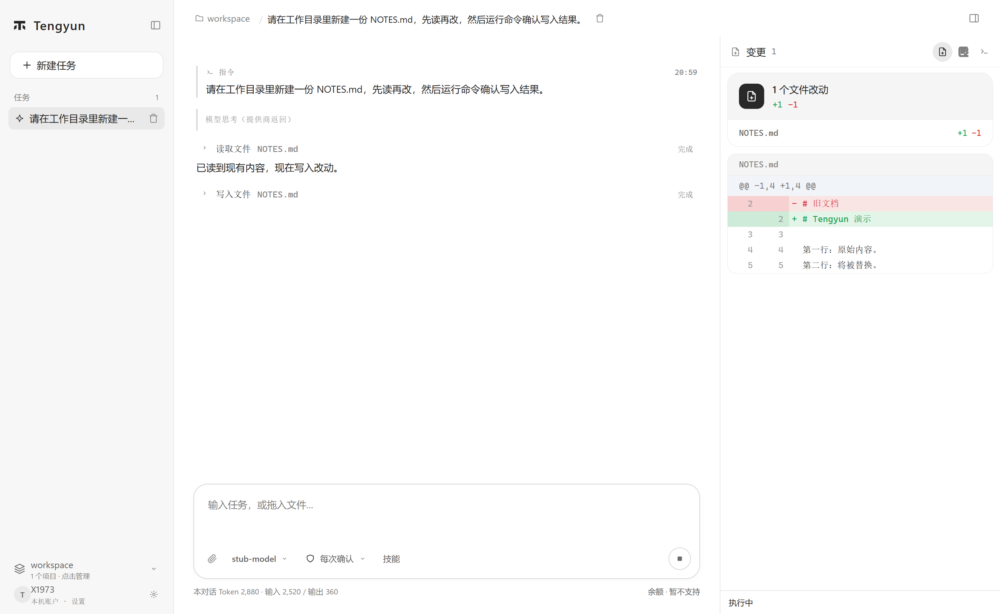
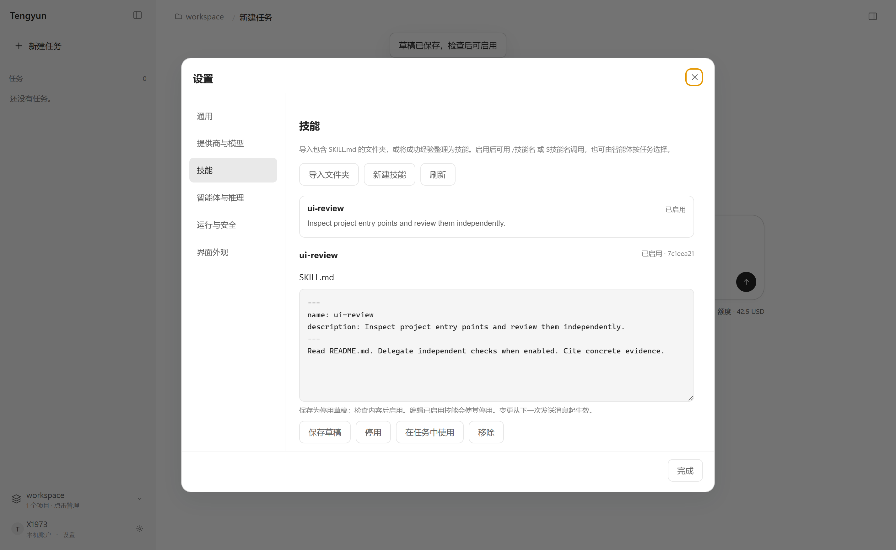

<div align="center">



# 腾云 · Tengyun

**完全独立的 Windows 编程 Agent。** 桌面、任务内核、工具层、存储都是自己的实现，不挂在任何其它 Agent 框架上运行——双击就用，没有启动脚本，没有后台服务。

<i>An independent, self-contained coding agent for Windows.</i>




</div>

## 这是什么

你描述想做的事，它自己列计划、读写文件、执行命令，并把每一步落成可以核对的执行证据。

它是一个完整的程序，不是别人框架上的一层壳：窗口、任务内核、工具分发、本地存储全部自带，`Tengyun.exe` 双击即用。模型接口由你填——任何兼容 Chat Completions 工具调用协议的网关都行。

- **独立实现**：不加载其它 Agent 框架的模块，不依赖外部启动器，不使用任何第三方更新服务。
- **本地优先**：任务、执行证据、技能、记忆全部存在你自己的目录里；没有遥测，不向任何官方服务回传。
- **每一步有证据**：模型说"完成"不算完成——计划项必须引用真实成功的工具证据才会被接受，伪造引用会被内核拒绝。
- **改动可回退**：写入前给出 unified diff，覆盖前自动备份，命令与提交都过审批。

## 核心能力

**任务内核**

- **先计划再动手**：模型先给出带依赖关系的任务计划，再调用工具；计划不能引用不存在的任务、不能成环、不能用失败结果充当完成证据。
- **流式输出**：模型走 SSE，助手消息边到边显示，命令输出按 250ms 批量推进界面；网关不支持流式时自动降级为一次性返回。
- **上下文预算器**：超过预算时按完整轮次折叠早期对话，保留系统提示与最近 12 轮，长任务不会撞上服务端上下文上限。
- **续跑**：在已有任务里继续发消息，会带上该任务的对话、计划和最近的工具结果。
- 轮数上限默认 60，最高 200，界面可调。

**工具层（可插拔能力注册表）**

- 内置的文件、命令、记忆、技能工具保留各自的路径与审批规则。
- 其余能力是 `kernel/capabilities/` 下的独立模块，每个模块导出 `definitions` 数组与 `run(name, args, context)`；新增一个能力只需丢一个文件、加一行 import，分发逻辑不用改。
- 审批门禁在工具分发处统一执行，能力模块无法绕过。

**技能与子智能体**

- 技能用 `SKILL.md`（frontmatter 写 `name` 与 `description`）描述，导入即用，可用 `/技能名` 调用；编辑已启用的技能会先转为草稿，改动从下一条消息起生效。
- 独立的检查类工作可以委派给子智能体并行执行，主任务不被拖住。

**界面**

- 三种外观：浅色、深色、壁纸。壁纸模式用你自己选的图，侧栏与面板用毛玻璃浮在图上。
- 右侧三块面板：**变更**（逐条审阅 unified diff）、**计划**（任务与依赖）、**终端**。
- 三级确认模式：每次确认（默认）／本次任务信任同类操作／全部自动，随时可切。

## 界面

<p align="center">
  
  
</p>

任务执行时，右侧直接给出这次改动的 unified diff，写入前后都可以逐行核对：



技能在设置里管理：导入包含 `SKILL.md` 的文件夹，或把跑通的经验整理成技能；启用后按名字调用。



## 快速开始

### 从源码构建

需要 Windows 10/11 x64、Node.js 22 或更新版本。

```powershell
git clone https://github.com/1420079678-ctrl/Tengyun.git
cd Tengyun
npm install
npm test                              # 内核回归测试
node build.mjs D:\Tengyun-release     # 打包出可运行的 Tengyun.exe
```

构建完成后进入输出目录，双击 `Tengyun.exe`。

### 配置模型

打开 **设置 → 提供商与模型**，填写兼容 Chat Completions 工具调用协议的接口地址、模型名与 API Key，选择工作目录，即可开始。API Key 用 Windows 当前用户的凭据加密保存，不以明文落盘。

## 数据与隐私

- 默认数据保存在程序旁的 `data\`，默认工作目录是程序旁的 `workspace\`；设置环境变量 `TENGYUN_HOME` 可指定到其它绝对路径。
- 没有遥测、没有自动更新。离开这台机器的只有：你交给模型的提示、进入上下文的文件内容、工具结果——它们只发往你自己配置的 API。
- 渲染进程保持 `contextIsolation: true`、`sandbox: true`、`nodeIntegration: false`；IPC 按窗口 + 主框架 + URL 逐字校验；文件工具限制在选定目录内，逐段校验路径并拒绝符号链接与 junction 逃逸。
- 覆盖已有文件前自动保存备份，删除与执行都能在变更面板里回溯。

## 当前边界

这个项目还在早期，说清楚它现在做不到什么：

- **未在真实厂商接口上做付费验证**：端到端测试跑的是本地模型桩，流式解析按 OpenAI SSE 规范实现并做了降级，但真实网关的表现尚未逐家实测。
- **没有跑过 SWE-bench 或其它可比基准**，不宣称超越任何现有 Agent。效果取决于你用的模型、接口支持与任务难度。
- **一个任务内的工具调用仍顺序执行**，跨任务并行调度与 MCP 尚未实现。
- **扩展生态尚未提供**：能力注册表已就位，能力模块目前覆盖 code / git / web / office 四类。
- **工作目录限制不等于操作系统沙箱**：命令经批准后以当前 Windows 用户权限执行。

验证过程、已通过项与已知问题记录在 [VALIDATION.md](VALIDATION.md)。

## 工具清单

| 类别 | 工具 |
| --- | --- |
| 文件 | `file_read`、`read_many`、`file_write`、`apply_patch`、`list_files`、`search_files`、`code_symbols` |
| 命令 | `run_command`（默认超时 60 秒，上限 10 分钟） |
| Git | `git_diff`（只读，无需确认）、`git_commit`（需确认） |
| 网页 | `web_fetch`（仅 HTTPS，返回正文纯文本） |
| 文档 | `office_docs`（PDF / Word / Excel / PPT 的构建、提取与渲染） |
| 记忆 | `memory_save`、`memory_search` |
| 技能 | `skill_list`、`skill_read`、`skill_draft` |

## 开发

```powershell
npm test         # 内核回归测试：node --test kernel/*.test.mjs
npm run verify   # 校验打包产物
```

仓库结构：

```text
main.mjs                主进程：窗口、凭据、审批
preload.cjs             受限 IPC 桥
kernel/                 任务内核：agent / primitives / tools / store / skills / telemetry / delegation
kernel/capabilities/    可插拔能力模块：code / git / web / office
ui/                     界面：原生 HTML + CSS + JS，无前端框架
tools/                  开发与端到端验证脚本（含模型桩）
docs/screenshots/       README 使用的界面截图
```

## 许可

[MIT](LICENSE)

---

如果你也觉得编程助手应该是一个装在自己电脑上、看得见每一步在做什么的独立程序，欢迎留下一个 **Star**，或者开 Issue 告诉我你希望它会点什么。这个项目会继续往前走。
